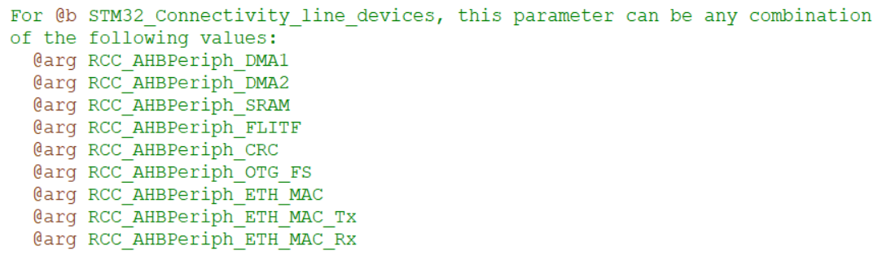
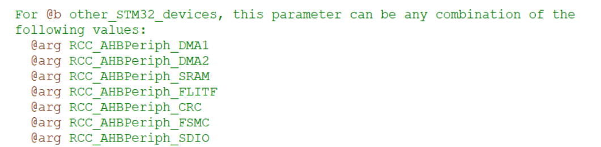
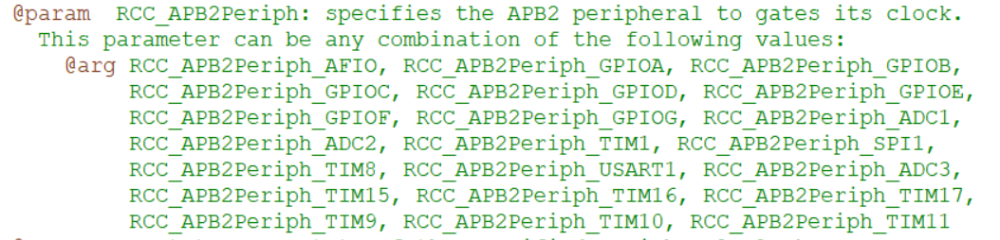
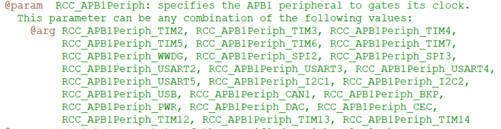
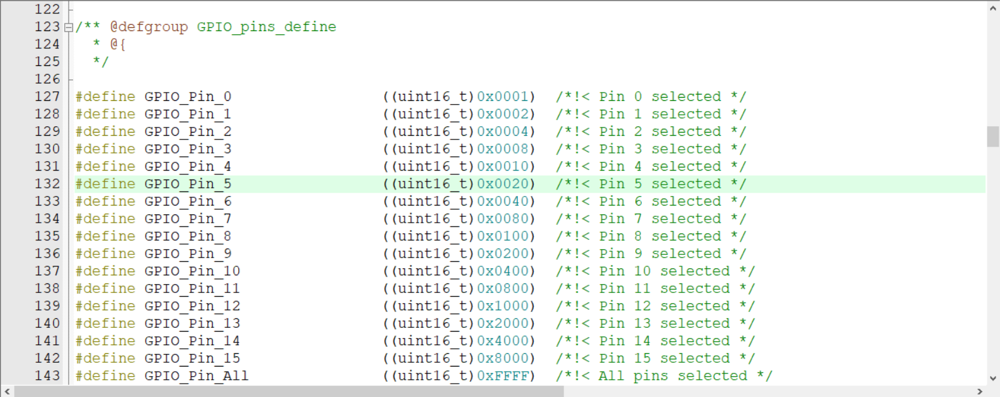

# STM32F10x 标准库外设函数汇总

## 一、RCC时钟

1. `void RCC_AHBPeriphClockCmd(uint32_t RCC_AHBPeriph, FunctionalState NewState);` RCC AHB外设时钟控制，使能或者失能AHB外设时钟。

第一个参数就是选择哪个外设，STM32互联网型设备可以在对应列表选择； 其他设备在对应列表选择。





第二个参数就是`ENABLE` or `DISABLE`。

1. `void RCC_APB2PeriphClockCmd(uint32_t RCC_APB2Periph, FunctionalState NewState);` RCC APB2外设时钟控制，使能或者失能APB2外设时钟。



第一个参数选择外设，查阅对应外设列表。 第二个参数使能或失能。

在STM32中，所有的GPIO都是挂载在APB2外设总线上的，所以要给PA0端口低电平点亮LED，需要给RCC_APB2外设时钟使能，第一个参数就选择`RCC_APB2Periph_GPIOA`，第二个参数为`ENABLE`。

```c
RCC_APB2PeriphClockCmd(RCC_APB2Periph_GPIOA,ENABLE);		
//将APB2总线上挂着的外设GPIOA时钟打开
```

1. `void RCC_APB1PeriphClockCmd(uint32_t RCC_APB1Periph, FunctionalState NewState);` RCC APB1外设时钟控制，使能或者失能APB1外设时钟。



第一个参数选择外设，查阅对应外设列表。 第二个参数使能或失能。

## 二、GPIO引脚

1. `void GPIO_DeInit(GPIO_TypeDef* GPIOx);` 参数可以写GPIOA、GPIOB等等，调用这个函数后，所指定的GPIO外设就会被复位。
2. `void GPIO_AFIODeInit(void);` 可以复位AFIO外设。
3. `void GPIO_Init(GPIO_TypeDef* GPIOx, GPIO_InitTypeDef* GPIO_InitStruct);` 这个函数的作用是，用结构体的参数来初始化GPIO口。

我们需要先定义一个结构体变量，然后再给结构体赋值，最后调用这个函数，这个函数内部就会自动读取结构体的值，然后自动把外设的各个参数配置好。

第一个参数是要初始化的GPIO口，第二个参数是一个结构体。

```c
GPIO_InitTypeDef GPIO_InitStructure;                //定义结构体变量
GPIO_InitStructure.GPIO_Mode = GPIO_Mode_Out_PP;    //GPIO模式选择
GPIO_InitStructure.GPIO_Pin = GPIO_Pin_0;           //GPIO引脚选择
GPIO_InitStructure.GPIO_Speed = GPIO_Speed_50MHz;   //GPIO传输速度选择
GPIO_Init(GPIOA, &GPIO_InitStructure);              //调用Init函数
```

这里的结构体就是一个数据打包的过程，首先将参数写到结构体的三个变量里，然后统一打包，将结构体传递到初始化函数里，接着在初始化函数里面，再把这个结构体拆包出来，读取变量，这就是使用结构体的整个过程。

第一行中`GPIO_InitTypeDef`是结构体的类型，`GPIO_InitStructure`是结构体的名字，这里结构体实际上也是一种局部变量。

在第二行，复制结构体名字，然后用`.`把结构体的成员都引出来；

通过在`GPIO_Mode`右键跳转，可以看到参数说明，在参数`GPIOMode_TypeDef`选中，Ctrl+F搜索一下，就能看到GPIO的8种工作模式，这里我们选择`GPIO_Mode_Out_PP`推挽输出模式。

```
GPIO_Mode_AIN = 0x0,                //模拟输入，ADC模数转换时的专用模式
GPIO_Mode_IN_FLOATING = 0x04,       //浮空输入，如果不确定外设的引脚默认状态，或者外部信号输出功率非常小，这时尽量选择浮空输入
GPIO_Mode_IPD = 0x28,               //下拉输入，如果连接的外设引脚默认低电平，则设置下拉输入
GPIO_Mode_IPU = 0x48,               //上拉输入，如果连接的外设引脚默认高电平，则设置上拉输入
GPIO_Mode_Out_OD = 0x14,            //开漏输出
GPIO_Mode_Out_PP = 0x10,            //推挽输出，一般输出引脚，最常用
GPIO_Mode_AF_OD = 0x1C,             //复用开漏
GPIO_Mode_AF_PP = 0x18              //复用推挽，如果使用引脚的复用功能，一般采用这个模式
```

第三行引脚选择，通过在`GPIO_Pin`右键跳转，在选中`GPIO_pins_define` 参数处Ctrl+F搜索，就能找到引脚定义，这里我们用的是GPIOA外设的0号引脚，所以选择`GPIO_Pin_0`。



第四行同理，能找到引脚的输出速度定义，这里我们选则50MHz即可。

第5行就是调用`GPIO_Init`函数，然后第一个参数写GPIOA，然后GPIO初始化结构体的地址放到`GPIO_Init`的第二个参数，这样初始化就完成了，`GPIO_Init`函数执行完，这个GPIOA外设的0号引脚就自动被配置为推挽输出，50MHz的速度了。接下来就可以使用GPIO的这些输入输出函数了。

它内部的主要执行逻辑就是读取结构体的参数，执行一堆判断和运算，最后写入到GPIO配置寄存器。

在`GPIO_InitStructure.GPIO_Pin`引脚选择中，如果要同时控制一个GPIO外设的多个引脚，可以：

```c
GPIO_InitStructure.GPIO_Pin = GPIO_Pin_0  |  GPIO_Pin_1  |  GPIO_Pin_2;
```

让要控制的引脚都按位“或”，这样其他引脚也就都被选中了。

这是因为GPIO0的引脚0对应数据为`0x0001`，换成二进制为`0000 0000 0000 0001`； GPIO1的引脚0对应数据为`0x0002`，换成二进制为`0000 0000 0000 0010`； GPIO2的引脚0对应数据为`0x0004`，换成二进制为`0000 0000 0000 0100`； GPIO3的引脚0对应数据为`0x0008`，换成二进制为`0000 0000 0000 1000`；

等等以此类推，每个端口都对应一个位，将它们按位“或”了以后，就变成了`0000 0000 0000 1111`，这样就相当于同时选中了3个端口，这就是按位或的操作逻辑。

当然也可以直接用`GPIO_Pin_ALL`，它对应数据就是`0xFFFF`，也就是所有位都为1，这样就相当于选中了所有的引脚。

这里除了`GPIO_Pin`可以用按位或的操作方式外， `RCC_APB2PeriphClockCmd(uint32_t RCC_APB2Periph, FunctionalState NewState);` 时钟控制（红色字体部分）的这一项，也是可以用按位或的操作方式来选择多个外设的。

`GPIO_SetBits(GPIO_TypeDef* GPIOx, uint16_t GPIO_Pin);` `GPIO_ResetBits(GPIO_TypeDef* GPIOx, uint16_t GPIO_Pin);` 函数红色字体部分都可以用按位或选择多个引脚。

1. `void GPIO_StructInit(GPIO_InitTypeDef* GPIO_InitStruct);` 这个函数可以把结构体变量赋一个默认值。

以下这四个函数是GPIO的写入函数。

1. `void GPIO_SetBits(GPIO_TypeDef* GPIOx, uint16_t GPIO_Pin);` 这个函数可以把指定的端口设置为高电平。

第一个参数是GPIOx，第二个参数是GPIO_Pin。

```c
GPIO_SetBits(GPIOA, GPIO_Pin_0);						
//将PA0口设置为高电平
```

1. `void GPIO_ResetBits(GPIO_TypeDef* GPIOx, uint16_t GPIO_Pin);` 这个函数可以把指定的端口设置为低电平。

第一个参数是GPIOx，第二个参数是GPIO_Pin。

```c
GPIO_ResetBits(GPIOA, GPIO_Pin_0);			
//将PA0口设置为低电平
```

1. `void GPIO_WriteBit(GPIO_TypeDef* GPIOx, uint16_t GPIO_Pin, BitAction BitVal);` 前两个参数都是指定端口，第三个参数是BitVal，根据第三个参数的值来设置指定端口。

第三个参数： `Bit_RESET`：清除端口值，也就是置低电平； `Bit_SET`：设置端口值，也就是置高电平。

```c
GPIO_WriteBit(GPIOA,GPIO_Pin_0,Bit_RESET);		
//给GPIOA中的0号引脚写入低电平（点亮LED）
```

1. `void GPIO_Write(GPIO_TypeDef* GPIOx, uint16_t PortVal);` 第一个参数是GPIOx，第二个参数是PortVal，这个函数可以同时对16个端口进行写入操作，它可以直接写到GPIO的ODR寄存器里。

```c
GPIO_Write(GPIOA, ~0x0001);
//对应二进制0000 0000 0000 0001
//这16个二进制分别对应PA0口导PA15总共16个端口
//最低位对应PA0，然后往上依次是PA1、PA2，一直到PA15
//因为是低电平点亮，所以前面加一个按位取反符号~
//这样就是第一个LED点亮，其他都熄灭。
```

以下四个函数是GPIO的读取函数。

1. `uint8_t GPIO_ReadInputDataBit(GPIO_TypeDef* GPIOx, uint16_t GPIO_Pin);` 这个函数是用来读取输入数据寄存器某一个端口的输入值，参数是GPIOx和GPIO_Pin，用来指定某一个端口。

返回值是uint8_t，代表这个端口的高低电平。

1. `uint16_t GPIO_ReadInputData(GPIO_TypeDef* GPIOx);` 这个函数比上一个函数少了一个Bit，它是用来读取整个输入数据寄存器的，参数只有一个GPIOx，用来指定外设。

返回值是uint16_t，是一个16位的数据，每一位代表一个端口值。

1. `uint8_t GPIO_ReadOutputDataBit(GPIO_TypeDef* GPIOx, uint16_t GPIO_Pin);` 这个函数是用来读取输出数据寄存器的某一位，所以它并不是用来读取端口的输入数据的，这个函数一般用于输出模式下，用来看一下自己输出的是什么。
2. `uint16_t GPIO_ReadOutputData(GPIO_TypeDef* GPIOx);` 这个函数比上一个函数少了一个Bit，是用来读取整个输出寄存器的。
3. `void GPIO_PinLockConfig(GPIO_TypeDef* GPIOx, uint16_t GPIO_Pin);` 这个函数是用来锁定GPIO配置的，调用这个函数，参数指定某个引脚，那这个引脚的配置就会被锁定，防止意外更改。
4. `void GPIO_PinRemapConfig(uint32_t GPIO_Remap, FunctionalState NewState);` 引脚重映射配置，通过查找引脚定义表，可以找到能够重映射配置的引脚。

第一个参数引脚重映射的方式，非常多，需要查找数据手册，来找到需要的方式。

数据手册中的情况，对应参数如上图所示，因此如果要将PA0的TIM2通道1功能重映射到PA15，第一个参数为`GPIO_PartialRemap1_TIM2`。

第二个参数使能，`ENABLE`。

由于PA15上电后默认复用为了调试端口JTDI，如果想让PA15作为普通的GPIO口或者复用定时器 的通道，还需要先关闭调试端口的复用。

如果`GPIO_PinRemapConfig()`第一个参数为

- `GPIO_Remap_SWJ_NoJTRST`：解除JTRST（PB4）引脚的复用，PB4就变成了正常的GPIO口；
- `GPIO_Remap_SWJ_JTAGDisable`：解除JTAG（PA15、PB3、PB4）调试端口的复用；
- `GPIO_Remap_SWJ_Disable`：解除SWD（PA13、PA14）和JTAG（PA15、PB3、PB4）全部5个端口的调试功能。

## 三、AFIO中断引脚选择数据器

1. `void GPIO_AFIODeInit(void);` 这个函数是用来复位AFIO外设的，调用一下这个函数，AFIO外设的配置就会全部清除。
2. `void GPIO_EventOutputConfig(uint8_t GPIO_PortSource, uint8_t GPIO_PinSource);` 用来配置AFIO的事件输出功能
3. `void GPIO_EventOutputCmd(FunctionalState NewState);` 用来配置AFIO的事件输出功能
4. `void GPIO_PinRemapConfig(uint32_t GPIO_Remap, FunctionalState NewState);` 用来进行引脚重映射，第一个参数可以选择要重映射的方式，第二个参数是新的状态。
5. `void GPIO_EXTILineConfig(uint8_t GPIO_PortSource, uint8_t GPIO_PinSource);` 调用这个函数，就可以配置AFIO的数据选择器，来选择我们想要的中断引脚。

第一个参数是选择某个GPIO外设作为外部中断源，这个参数可以是`GPIO_PortSourceGPIOx`，其中x是A~G。

第二个参数是`GPIO_PinSourcex`，指定要配置的外部中断线，其中x是0~15。

```c
GPIO_EXTILineConfig(GPIO_PortSourceGPIOB, GPIO_PinSource14);		
//AFIO外部中断引脚选择配置
```

第一个参数是选择GPIOB作为外部中断源，第二个参数表示选择EXTI连接PB14号口的第14个中断线路。

## 四、EXTI外部中断

1. `void EXTI_DeInit(void);` 调用这个函数，就可以把EXTI的配置都清除，恢复成上电时默认的状态。
2. `void EXTI_Init(EXTI_InitTypeDef* EXTI_InitStruct);` 调用这个函数，就可以根据这个结构体里的参数来配置EXTI外设，来初始化EXIT，使用方法和GPIO类似。

```
EXTI_InitTypeDef EXTI_InitStructure;
EXTI_InitStructure.EXTI_Line = EXTI_Line14;							//要配置的中断线
EXTI_InitStructure.EXTI_LineCmd = ENABLE;							//指定选择中断线的新状态
EXTI_InitStructure.EXTI_Mode = EXTI_Mode_Interrupt;					//外部中断线的模式
EXTI_InitStructure.EXTI_Trigger = EXTI_Trigger_Falling;				//中断触发方式选择
EXTI_Init(&EXTI_InitStructure );
```

这里的结构体参数有四个，作用分别为：

- `EXTI_Line`：是选择配置的中断线，由于我们使用的是PB14，所以需要用到EXTI14中断线，共有20根中断线可以选择。
- `EXTI_LineCmd`：指定选择中断线的新状态，可以选择`ENABLE`和`DISABLE`，这里我们是要配置中断，所以肯定是要选择`ENABLE`。
- `EXTI_Mode`：外部中断线的模式，有中断响应和事件响应两种，这里我们要让CPU执行中断，因此选择中断响应`EXTI_Mode_Interrupt`。
- `EXTI_Trigger`：中断触发方式选择，有四种，分别是上升沿、下降沿、双边沿，因为之前的GPIO口是选的上拉模式，即没信号影响的时候那个口是高电平，那有信号来的就对应的是电平从高到低，即下降沿，因此我们这里选择下降沿触发`EXTI_Trigger_Falling`。

在对射式红外传感器计次程序中，下降沿触发是在移开挡光片的时候触发中断，如果是上升沿触发，则是放入挡光片的时候触发中断，如果是双边沿触发，则放入挡光片和移开挡光片的时候都会触发中断，也就是放一次挡光片就会触发两次中断。

1. `void EXTI_StructInit(EXTI_InitTypeDef* EXTI_InitStruct);` 调用这个函数，可以把参数传递的结构体变量`EXTI_InitStruct`，赋一个默认值。
2. `void EXTI_GenerateSWInterrupt(uint32_t EXTI_Line);` 这个函数是用软件来触发外部中断的，调用这个函数，参数给一个指定的中断线，就能软件触发一次这个外部中断。

在外设运行过程中，会产生一些状态标志位，比如外部中断来了，会在挂起寄存器使一个标志位置1，对于其他外设，如串口收到数据，也会置标志位，定时器时间到，也会置标志位，这些标志位都是放在状态寄存器内的，当程序想要看到这些标志位时，就可以用到下面四个函数。

1. `FlagStatus EXTI_GetFlagStatus(uint32_t EXTI_Line);` 可以获取指定的标志位是否被置1了。
2. `void EXTI_ClearFlag(uint32_t EXTI_Line);` 可以对置1的标志位进行清除。

如果想在主程序查看和清除标志位，就用上面两个函数。

对于有些比较紧急的标志位，在置标志位后，会触发中断，在中断函数中，如果想查看标志位和清除标志位，那就用下面两个函数。

1. `ITStatus EXTI_GetITStatus(uint32_t EXTI_Line);` 获取中断标志位是否被置1。

```
EXTI_GetITStatus(EXTI_Line14);
```

上面代码就是查看EXTI14的中断标志位是否为1，返回值是`SET` or `RESET`，若返回值是`SET`，则说明EXTI14的中断标志位为1，若返回值是`RESET`，说明EXTI14的中断标志位还是为0。

1. `void EXTI_ClearITPendingBit(uint32_t EXTI_Line);` 清除中断挂起标志位。

```
EXTI_ClearITPendingBit(EXTI_Line14)
```

在每次中断程序结束后，一定要再调用一下清除中断标志位的函数，因为只要中断标志位置1了，程序就会跳转到中断函数， 如果不清除中断标志位，那它就会一直申请中断，这样程序就会不断响应中断，执行中断函数，那程序就会卡死在中断函数中，所以每次中断程序结束后，都应该清除一下中断标志位。

上面这段程序的作用就是清除EXTI14的中断标志位。

## 五、NVIC嵌套中断向量控制器

1. `void NVIC_PriorityGroupConfig(uint32_t NVIC_PriorityGroup);` 这个函数是用来中断分组的，参数是中断分组的方式。

```
NVIC_PriorityGroupConfig(NVIC_PriorityGroup_2);			//中断优先级分组
NVIC_InitTypeDef NVIC_InitStructure;
NVIC_InitStructure.NVIC_IRQChannel = EXTI15_10_IRQn;				//选择指定通道
NVIC_InitStructure.NVIC_IRQChannelCmd = ENABLE;						//开启指定通道	
NVIC_InitStructure.NVIC_IRQChannelSubPriority = 1;					//给响应优先级分配优先级程度
NVIC_InitStructure.NVIC_IRQChannelPreemptionPriority = 1;			//给抢占优先级分配优先级程度
NVIC_Init(&NVIC_InitStructure);
```

函数简介是配置优先级分组：抢占优先级和响应优先级

参数可以选择`NVIC_PriorityGroup_0~4`，共有5种分组情况，如果中断不多，很难导致中断冲突，对优先级分组来说，哪个分组情况都可以，这里选择第三个分组，也就是`NVIC_PriorityGroup_2`，2位抢占，2位响应，比较平均一些。

> 注意：分组方式整个芯片只能用一种，所以这个分组的代码，整个工程只需要执行一次就好了，如果在模块里面进行分组，要确保每个模块分组都选的是同一个，或者也可以把这个分组代码放在主函数的最开始，这样模块里就不用再分组了。

1. `void NVIC_Init(NVIC_InitTypeDef* NVIC_InitStruct);` 根据结构体里面指定的参数初始化NVIC。

```
NVIC_InitTypeDef NVIC_InitStructure;
NVIC_InitStructure.NVIC_IRQChannel = EXTI15_10_IRQn;		//选择指定通道
NVIC_InitStructure.NVIC_IRQChannelCmd = ENABLE;			    //开启指定通道	
NVIC_InitStructure.NVIC_IRQChannelSubPriority = 1;			//给响应优先级分配优先级程度
NVIC_InitStructure.NVIC_IRQChannelPreemptionPriority = 1;	//给抢占优先级分配优先级程度
NVIC_Init(&NVIC_InitStructure);
```

这里的结构体参数有四个，作用分别为：

- `NVIC_IRQChannel`：选择指定通道，它的通道列表在`STM32F10x.h`文件里，STM32单片机芯片是MD中等密度的，因此找到`STM32F10x_MD`，往下翻，就能看到`EXTI15_10_IRQn`中断通道，STM32的EXTI10到EXTI15都是合并到了这个通道里。
- `IRQChannelCmd`：使能或失能指定通道，这里我们肯定是要打开中断通道的，因此我们选择`ENABLE`。
- `NVIC_IRQChannelSubPriority`：给响应优先级分配优先级程度，这里我们中断分组是2，因此响应优先级和抢占优先级的取值范围都是0~3，有因为中断只有一个，所以取值1即可。
- `NVIC_IRQChannelPreemptionPriority`：给抢占优先级分配优先级程度，取值1。

1. `void NVIC_SetVectorTable(uint32_t NVIC_VectTab, uint32_t Offset);` 设置中断向量表。
2. `void NVIC_SystemLPConfig(uint8_t LowPowerMode, FunctionalState NewState);` 系统低功耗配置

## 六、TIM定时器

1. `void TIM_DeInit(TIM_TypeDef* TIMx);` 恢复缺省配置，意思是把当前的状态或设置恢复到系统的初始默认状态。
2. `void TIM_TimeBaseInit(TIM_TypeDef* TIMx, TIM_TimeBaseInitTypeDef* TIM_TimeBaseInitStruct);` 时基单元初始化，第一个参数TIMx选择某个定时器，第二个是结构体，里面包含了配置时基单元的一些参数。

```
TIM_TimeBaseInitTypeDef TIM_TimeBaseInitStruct;
TIM_TimeBaseInitStruct.TIM_ClockDivision = TIM_CKD_DIV1;		//指定时钟分频
TIM_TimeBaseInitStruct.TIM_CounterMode = TIM_CounterMode_Up;	//计数器模式
TIM_TimeBaseInitStruct.TIM_Period = 10000 - 1;					//自动重装器的值
TIM_TimeBaseInitStruct.TIM_Prescaler = 7200 - 1;				//PSC预分频器的值
TIM_TimeBaseInitStruct.TIM_RepetitionCounter = 0;				//重复计数器的值
TIM_TimeBaseInit(TIM2, &TIM_TimeBaseInitStruct);			//初始化时基单元
```

（1）`TIM_ClockDivision`：指定时钟分频，`TIM_CKD_DIV1`，1分频，也就是不分频；还有2分频、4分频。 （2）`TIM_CounterMode`：计数器模式，Up是向上计数，Down是向下计数，后面是三种中央对齐的模式。 （3,4）`TIM_Period`、`TIM_Prescaler`：分别是自动重装器的值和预分频的值，如果我们想要定时1s，定时时间=1/定时频率，也就是定时频率为1Hz，根据公式`定时频率=72MHz/（预分频器值+1）/（自动重装值+1）`，所以预分频器值设为`7200-1`，自动重装值设为`10000-1`，即`1Hz=72×10^6Hz /7200 /10000`，PSC预分频器值和ARR自动重装值均为0~65535之间，且这两个值不唯一，在满足上面公式的情况下，都可以。 （5）`TIM_RepetitionCounter`：重复计数器的值，高级定时器才用到，这里不需要用到，给0。

1. `void TIM_TimeBaseStructInit(TIM_TimeBaseInitTypeDef* TIM_TimeBaseInitStruct);` 这个函数可以把结构体变量赋一个默认值。
2. `void TIM_Cmd(TIM_TypeDef* TIMx, FunctionalState NewState);` 用来使能计数器， 第一个参数TIMx选择定时器，第二个参数NewState新的状态，也就是使能还是失能，使能就是打开计数器开始计数，失能就是关闭计数器。

```
TIM_Cmd(TIM2,ENABLE);	//启动TIM2定时器
```

1. `void TIM_ITConfig(TIM_TypeDef* TIMx, uint16_t TIM_IT, FunctionalState NewState);` 用来使能中断输出信号，第一个参数TIMx选择定时器，第二个参数TIM_IT，选择要配置哪个中断输出，第三个参数NewState新的状态，使能或失能。

使用这个函数后，就开启了更新中断到NVIC的通路。

```
TIM_ITConfig(TIM2,TIM_IT_Update,ENABLE);							//使能中断	
```

第二个参数TIM_IT可以是下面值的任意组合。 `Update`：更新中断。

1. `void TIM_InternalClockConfig(TIM_TypeDef* TIMx);` 选择内部时钟，参数TIMx选择定时器。

```
void TIM_InternalClockConfig(TIM2);	
//选择内部时钟来驱动TIM2，不写也是默认内部时钟驱动
```

1. `void TIM_ITRxExternalClockConfig(TIM_TypeDef* TIMx, uint16_t TIM_InputTriggerSource);` 选择ITRx其他定时器的时钟，第一个参数TIMx选择定时器，第二个参数`TIM_InputTriggerSource`，选择要接入哪个其他的定时器。
2. `void TIM_TIxExternalClockConfig(TIM_TypeDef* TIMx, uint16_t TIM_TIxExternalCLKSource, uint16_t TIM_ICPolarity, uint16_t ICFilter);` 选择TIx捕获通道的时钟，第一个参数TIMx选择定时器，第二个参数`TIM_TIxExternalCLKSource`，选择TIx具体的某个引脚，第三个参数`TIM_ICPolarity`，输入的极性，第四个参数ICFilter滤波器。

对于外部引脚的波形，一般都会有极性选择和滤波器，这样更灵活一些。

1. `void TIM_ETRClockMode1Config(TIM_TypeDef* TIMx, uint16_t TIM_ExtTRGPrescaler, uint16_t TIM_ExtTRGPolarity, uint16_t ExtTRGFilter);` 选择ETR通过外部时钟模式1输入的时钟，第一个参数TIMx选择定时器， 第二个参数`TIM_ExtTRGPrescaler`：外部触发预分频器，这里可以对ETR的外部时钟再提前做一个分频，一般是不需要分频的； 第三个参数是极性，如果是反向Inverted，低电平或者下降沿有效；如果是不反向NonInverted，则是高电平或者上升沿有效。 第四个参数是滤波器，这个值可以是`0x00`到`0x0F`之间的一个值，它是以一个采样频率 f 采样N个点，如果N个点都一样，才会有效输出，这个值就是来决定 f 和N的。
2. `void TIM_ETRClockMode2Config(TIM_TypeDef* TIMx, uint16_t TIM_ExtTRGPrescaler, uint16_t TIM_ExtTRGPolarity, uint16_t ExtTRGFilter);` 选择ETR通过外部时钟模式2输入的时钟，参数和上面函数一致。

对于ETR输入的外部时钟而言，这两个函数是等效的，它们的参数也是一样的，如果不需要触发输入的功能，那两个函数可以互换。

1. `void TIM_ETRConfig(TIM_TypeDef* TIMx, uint16_t TIM_ExtTRGPrescaler, uint16_t TIM_ExtTRGPolarity, uint16_t ExtTRGFilter);` 用来配置ETR引脚的预分频器、极性、滤波器这些参数的。
2. `void TIM_PrescalerConfig(TIM_TypeDef* TIMx, uint16_t Prescaler, uint16_t TIM_PSCReloadMode);` 用来单独写预分频值，第一个参数TIMx选择定时器，第二个参数Prescaler，要写入的预分频值， 第三个参数为写入的模式：

- `TIM_PSCReloadMode_Update`：可以选择是听从安排，在更新事件（即一个信号周期）后生效；
- `TIM_PSCReloadMode_Immediate`：在写入后，手动产生一个更新事件（在信号周期内），让这个值立刻生效。

1. `void TIM_CounterModeConfig(TIM_TypeDef* TIMx, uint16_t TIM_CounterMode);` 用来改变计数器的计数模式，第一个参数TIMx选择定时器，第二个参数`TIM_CounterMode`，选择新的计数器模式。
2. `void TIM_ARRPreloadConfig(TIM_TypeDef* TIMx, FunctionalState NewState);` 自动重装器预装功能配置，第一个参数TIMx选择定时器，第二个参数NewState新的状态，使能则是有预装功能，失能则没有预装功能。
3. `void TIM_SetCounter(TIM_TypeDef* TIMx, uint16_t Counter);` 给计数器写入一个值，如果想手动给一个计数值，就可以用这个函数。
4. `void TIM_SetAutoreload(TIM_TypeDef* TIMx, uint16_t Autoreload);` 给自动重装器写入一个值，如果想手动给一个自动重装值，就可以用这个函数。
5. `uint16_t TIM_GetCounter(TIM_TypeDef* TIMx);` 获取当前计数器的值，如果想看当前计数器计数到哪里了，就可以调用一下这个函数。
6. `uint16_t TIM_GetPrescaler(TIM_TypeDef* TIMx);` 获取当前的预分频器的值。
7. 

```
FlagStatus TIM_GetFlagStatus(TIM_TypeDef* TIMx, uint16_t TIM_FLAG);
void TIM_ClearFlag(TIM_TypeDef* TIMx, uint16_t TIM_FLAG);
ITStatus TIM_GetITStatus(TIM_TypeDef* TIMx, uint16_t TIM_IT);
void TIM_ClearITPendingBit(TIM_TypeDef* TIMx, uint16_t TIM_IT);
```

`TIM_Get`是查看指定的定时器中断标志位是否置1，Clear是清除标志位为0。

1. `void TIM_OC1Init(TIM_TypeDef* TIMx, TIM_OCInitTypeDef* TIM_OCInitStruct);` 这个函数就是用来配置定时器的输出比较功能的，第一个参数是定时器选择，第二个参数是结构体，就是配置输出比较功能内部的一些参数。

```
/*输出比较初始化*/
TIM_OCInitTypeDef TIM_OCInitStructure;							//定义结构体变量
TIM_OCStructInit(&TIM_OCInitStructure);							//结构体初始化，若结构体没有完整赋值
																	//则最好执行此函数，给结构体所有成员都赋一个默认值
																	//避免结构体初值不确定的问题
TIM_OCInitStructure.TIM_OCMode = TIM_OCMode_PWM1;				//输出比较模式，选择PWM模式1
TIM_OCInitStructure.TIM_OCPolarity = TIM_OCPolarity_High;		//输出极性，选择为高，若选择极性为低，则输出高低电平取反
TIM_OCInitStructure.TIM_OutputState = TIM_OutputState_Enable;	//输出使能
TIM_OCInitStructure.TIM_Pulse = 0;								//初始的CCR值
TIM_OC1Init(TIM2, &TIM_OCInitStructure);						//将结构体变量交给TIM_OC1Init，配置TIM2的输出比较通道1
```

（1）`TIM_OCMode`，输出比较模式

- `TIM_OCMode_Timing`：冻结模式
- `TIM_OCMode_Active`：相等时置有效电平
- `TIM_OCMode_Inactive`：相等时置无效电平
- `TIM_OCMode_Toggle`：相等时电平翻转
- `TIM_OCMode_PWM1`：PWM模式1
- `TIM_OCMode_PWM2`：PWM模式2

（2）`TIM_OCPolarity`，输出比较极性

- `TIM_OCPolarity_High`：高极性，有效电平是高电平，REF有效时，输出高电平；
- `TIM_OCPolarity_Low`：低极性，有效电平是低电平，REF有效时，输出低电平。

（3）`TIM_OutputState`：输出使能端口，`ENABLE`使能，`DISABLE`失能。

（4）`TIM_Pulse`：设置CCR（比较寄存器）的值

1. `void TIM_OCStructInit(TIM_OCInitTypeDef* TIM_OCInitStruct);` 这个函数是用来给输出比较结构体赋一个默认值的。
2. `void TIM_SetCompare1(TIM_TypeDef* TIMx, uint16_t Compare1);` 这个函数是用设置CCR（比较/捕获寄存器）的值，第一个参数TIMx选择定时器，第二个参数Compare要写入的CCR的值，范围：0~100。
3. `uint16_t TIM_GetCapture1(TIM_TypeDef* TIMx);` 输出比较模式下，CCR是只写的，要用`SetCompare`函数写入； 输入捕获模式下，CCR是只读的，要用`GetCapture`函数读取；
4. `void TIM_ICInit(TIM_TypeDef* TIMx, TIM_ICInitTypeDef* TIM_ICInitStruct);` 这个函数就是用来配置定时器的输入捕获功能的，第一个参数是定时器选择，第二个参数是结构体，就是配置输出比较功能内部的一些参数，第三个参数选择通道。

```
/*输入捕获初始化*/
TIM_ICInitTypeDef TIM_ICInitStructure;							//定义结构体变量
TIM_ICInitStructure.TIM_Channel = TIM_Channel_1;				//选择配置定时器通道1
TIM_ICInitStructure.TIM_ICFilter = 0xF;							//输入滤波器参数，可以过滤信号抖动
TIM_ICInitStructure.TIM_ICPolarity = TIM_ICPolarity_Rising;		//极性，选择为上升沿触发捕获
TIM_ICInitStructure.TIM_ICPrescaler = TIM_ICPSC_DIV1;			//捕获预分频，选择不分频，每次信号都触发捕获
TIM_ICInitStructure.TIM_ICSelection = TIM_ICSelection_DirectTI;	//输入信号交叉，选择直通，不交叉
TIM_ICInit(TIM3, &TIM_ICInitStructure);							//将结构体变量交给TIM_ICInit，配置TIM3的输入捕获通道
```

（1）`TIM_Channel`：选择定时器通道（共4个通道） （2）`TIM_ICFilter`：用来配置滤波器参数，可以过滤信号抖动问题，参数范围`0x0~0xF`，数越大，滤波效果越好。 （3）`TIM_ICPolarity`：极性选择

- `Rising`：上升沿触发；
- `Falling`：下降沿触发；
- `BothEdge`：上升沿、下降沿都触发。 （4）`TIM_ICPrescaler`：分频器，不分频就是每次触发都有效，2分频就是2次信号才有效一次，这里有`DIV1`（不分频），`DIV2`（2分频），`DIV4`（4分频），`DIV8`（8分频）。 （5）`TIM_ICSelection`：选择触发信号从哪个引脚输入。 `DirectTI`：直连通道；`IndirectTI`：交叉通道；`TRC`：暂时用不到。

1. `void TIM_PWMIConfig(TIM_TypeDef* TIMx, TIM_ICInitTypeDef* TIM_ICInitStruct);` 也是用来初始化配置输入捕获功能的，上一个函数只能单一地配置一个通道，而这个函数可以配置两个通道，把外设电路结构配置成PWMI模式。

```
/*PWMI模式初始化*/
TIM_ICInitTypeDef TIM_ICInitStructure;							//定义结构体变量
TIM_ICInitStructure.TIM_Channel = TIM_Channel_1;				//选择配置定时器通道1
TIM_ICInitStructure.TIM_ICFilter = 0xF;							//输入滤波器参数，可以过滤信号抖动
TIM_ICInitStructure.TIM_ICPolarity = TIM_ICPolarity_Rising;		//极性，选择为上升沿触发捕获
TIM_ICInitStructure.TIM_ICPrescaler = TIM_ICPSC_DIV1;			//捕获预分频，选择不分频，每次信号都触发捕获
TIM_ICInitStructure.TIM_ICSelection = TIM_ICSelection_DirectTI;	//输入信号交叉，选择直通，不交叉
TIM_PWMIConfig(TIM3, &TIM_ICInitStructure);						//将结构体变量交给TIM_PWMIConfig，配置TIM3的输入捕获通道
																	//此函数同时会把另一个通道配置为相反的配置，实现PWMI模式
```

1. `void TIM_SelectInputTrigger(TIM_TypeDef* TIMx, uint16_t TIM_InputTriggerSource);` 选择输入触发源TRGI，从模式的触发源选择就是用的这个函数。

```
TIM_SelectInputTrigger(TIM3, TIM_TS_TI1FP1);		//触发源选择TI1FP1
```

1. `void TIM_SelectOutputTrigger(TIM_TypeDef* TIMx, uint16_t TIM_TRGOSource);` 选择输出触发源TRGO，主模式的输出触发源选择就是调用这个函数。
2. `void TIM_SelectSlaveMode(TIM_TypeDef* TIMx, uint16_t TIM_SlaveMode);` 选择从模式功能，在从模式得到TRGI触发后，会选择一项从模式中的功能进行执行。

```
TIM_SelectSlaveMode(TIM3, TIM_SlaveMode_Reset);		//从模式选择复位
```

1. `void TIM_EncoderInterfaceConfig(TIM_TypeDef* TIMx, uint16_t TIM_EncoderMode, uint16_t TIM_IC1Polarity, uint16_t TIM_IC2Polarity);` 定时器编码器接口配置函数，第一个参数选择定时器，第二个参数选择编码器模式（仅TI1计数，仅TI2计数，TI1和TI2都计数），后面两个参数分别是选择通道1和通道2的电平极性（Rising代表不反相，Falling代表反相）。

## 七、ADC模数转换器

1. `void RCC_ADCCLKConfig(uint32_t RCC_PCLK2);` 用来配置ADCCLK分频器，它可以对APB2的72MHz时钟进行2、4、6、8分频。

```
/*设置ADC时钟*/
RCC_ADCCLKConfig(RCC_PCLK2_Div6);  //选择时钟6分频，ADCCLK（ADC时钟） = 72MHz / 6 = 12MHz
```

`void ADC_DeInit(ADC_TypeDef* ADCx);` `void ADC_StructInit(ADC_InitTypeDef* ADC_InitStruct);` 这两个功能跟之前一样，不展开介绍

1. `void ADC_Init(ADC_TypeDef* ADCx, ADC_InitTypeDef* ADC_InitStruct);` ADC初始化函数

```
/*ADC初始化*/
ADC_InitTypeDef ADC_InitStructure;						//定义结构体变量
ADC_InitStructure.ADC_Mode = ADC_Mode_Independent;		//模式，选择独立模式，即单独使用ADC1
ADC_InitStructure.ADC_DataAlign = ADC_DataAlign_Right;	//数据对齐，选择右对齐
ADC_InitStructure.ADC_ExternalTrigConv = ADC_ExternalTrigConv_None;	//外部触发，使用软件触发，不需要外部触发
ADC_InitStructure.ADC_ContinuousConvMode = DISABLE;		//连续转换，失能，每转换一次规则组序列后停止
ADC_InitStructure.ADC_ScanConvMode = DISABLE;			//扫描模式，失能，只转换规则组的序列1这一个位置
ADC_InitStructure.ADC_NbrOfChannel = 1;					//通道数，为1，仅在扫描模式下，才需要指定大于1的数，在非扫描模式下，只能是1
ADC_Init(ADC1, &ADC_InitStructure);						//将结构体变量交给ADC_Init，配置ADC1
```

（1）`ADC_Mode`，ADC的工作模式，Independent是ADC的独立工作模式，ADC1和ADC2各自独立转换，剩下的都是ADC1和ADC2共同工作的双模式。 （2）`ADC_DataAlign`，ADC是12位的，但是数据寄存器是16位的，所以就存在一个数据对齐的问题。一般选择右对齐，这样读取这个数据寄存器，直接就是转换的结果。如果选择左对齐，得到的数据会比实际大16倍。 （3）`ADC_ExternalTrigConv`，选择外部触发转换的触发源。None就是不选择外部触发，即使用内部软件触发。 （4）`ADC_ContinuousConvMode`，连续转换模式，可选择连续转换还是单次转换。 `ENABLE`，连续模式；`DISABLE`，单次模式。 （5）`ADC_ScanConvMode`，扫描转换模式，可选择扫描模式还是非扫描模式。 `ENABLE`，扫描模式；`DISABLE`，非扫描模式。 （6）`ADC_NbrOfChannel`，通道数目，在指定扫描模式下，总共使用到的通道个数。参数范围1~16。

1. `void ADC_Cmd(ADC_TypeDef* ADCx, FunctionalState NewState);` 给ADC上电，功能相当于开关控制。第一个参数选择ADC，第二个参数`ENABLE`打开。
2. `void ADC_DMACmd(ADC_TypeDef* ADCx, FunctionalState NewState);` 用于开启DMA输出信号，如果使用DMA转运数据，就得调用这个函数。
3. 

```
void ADC_ResetCalibration(ADC_TypeDef* ADCx);
FlagStatus ADC_GetResetCalibrationStatus(ADC_TypeDef* ADCx);
void ADC_StartCalibration(ADC_TypeDef* ADCx);
FlagStatus ADC_GetCalibrationStatus(ADC_TypeDef* ADCx);
```

上面四个函数分别是复位校准、获取复位校准状态、开始校准和获取开始校准状态。这四个就是用于控制校准的函数，在ADC初始化完成后，依次调用就能使用。

```
/*ADC校准*/
ADC_ResetCalibration(ADC1);								//固定流程，内部有电路会自动执行校准
while (ADC_GetResetCalibrationStatus(ADC1) == SET);
ADC_StartCalibration(ADC1);
while (ADC_GetCalibrationStatus(ADC1) == SET);
```

1. `void ADC_SoftwareStartConvCmd(ADC_TypeDef* ADCx, FunctionalState NewState);` 这个是用于软件触发AD转换的函数。
2. `void ADC_RegularChannelConfig(ADC_TypeDef* ADCx, uint8_t ADC_Channel, uint8_t Rank, uint8_t ADC_SampleTime);` 这个函数用来规则组通道配置，它的作用是给转换模式中序列的每个位置填写指定通道，第一个参数是选择使用的ADC，第二个参数是指定的通道，第三个参数是序列的位置，第四个参数是指定通道的采样时间。

```
/*规则组通道配置*/
ADC_RegularChannelConfig(ADC1, ADC_Channel_0, 1, ADC_SampleTime_55Cycles5);		
//规则组序列1的位置，配置为通道0，采样时间为55.5个ADCCLK周期
```

第四个参数可填的采样时间，需要更快转换，就填写更小的参数，需要更稳定的转换，就填写更大的参数。

1. `uint16_t ADC_GetConversionValue(ADC_TypeDef* ADCx);` 这个函数是用来获取AD转换的数据寄存器，它会直接读取ADC的DR寄存器，读取完成后，还会自动将转换完成EOC标志位清0。
2. `FlagStatus ADC_GetFlagStatus(ADC_TypeDef* ADCx, uint8_t ADC_FLAG);` 获取ADC标志位状态函数。第一个参数选择ADC，第二个参数

- `AWD`：模拟看门狗标志位；
- `EOC`：规则组或注入组转换完成标志位；
- `JEOC`：注入组转换完成标志位；
- `JSTRT`：注入组开始转换标志位；
- `STRT`：规则组开始转换标志位。

## 八、DMA数据转运

1. `void DMA_Init(DMA_Channel_TypeDef* DMAy_Channelx, DMA_InitTypeDef* DMA_InitStruct);` DMA初始化函数

```
/*DMA初始化*/
DMA_InitTypeDef DMA_InitStructure;										//定义结构体变量
DMA_InitStructure.DMA_PeripheralBaseAddr = AddrA;						//外设基地址，给定形参AddrA
DMA_InitStructure.DMA_PeripheralDataSize = DMA_PeripheralDataSize_Byte;	//外设数据宽度，选择字节
DMA_InitStructure.DMA_PeripheralInc = DMA_PeripheralInc_Enable;			//外设地址自增，选择使能
DMA_InitStructure.DMA_MemoryBaseAddr = AddrB;							//存储器基地址，给定形参AddrB
DMA_InitStructure.DMA_MemoryDataSize = DMA_MemoryDataSize_Byte;			//存储器数据宽度，选择字节
DMA_InitStructure.DMA_MemoryInc = DMA_MemoryInc_Enable;					//存储器地址自增，选择使能
DMA_InitStructure.DMA_DIR = DMA_DIR_PeripheralSRC;						//数据传输方向，选择由外设到存储器
DMA_InitStructure.DMA_BufferSize = Size;								//转运的数据大小（转运次数）
DMA_InitStructure.DMA_Mode = DMA_Mode_Normal;							//模式，选择正常模式
DMA_InitStructure.DMA_M2M = DMA_M2M_Enable;								//存储器到存储器，选择使能
DMA_InitStructure.DMA_Priority = DMA_Priority_Medium;					//优先级，选择中等
DMA_Init(DMA1_Channel1, &DMA_InitStructure);							//将结构体变量交给DMA_Init，配置DMA1的通道1
```

（1）`DMA_PeripheralBaseAddr`：外设基地址，需要写一个32位地址，比如`0x20000000`，对于SRAM的数组，它的地址是编译器分配的，并不是固定的，因此一般不会写绝对地址，而是通过数组名来获取地址。

可以将这个基地址提取成初始化函数的形参AddrA，初始化时，想转运哪个数组，就把哪个数组的地址传进来即可。

（2）`DMA_PeripheralDataSize`：外设数据宽度，字节Byte（uint8_t，8位）、半字HalfWord（uint16_t，16位）和字Word（uint32_t，32位）

（3）`DMA_PeripheralInc`：外设地址是否自增，Enable自增，Disable不自增。

（4）`DMA_MemoryBaseAddr`：存储器基地址，提取成初始化函数的形参AddrB。

（5）`DMA_MemoryDataSize`：存储器数据宽度，与第二个类似。

（6）`DMA_MemoryInc`：存储器地址是否自增，与第三个类似。

（7）`DMA_DIR`：传输方向， DST外设站点作为目的地，传输方向是存储器站点到外设站点；SRC外设站点作为源头，传输方向是外设站点到存储器。

（8）`DMA_BufferSize`：传输计数器，提取成初始化函数的形参Size，范围是0~65535。

（9）`DMA_Mode`：是否使用重装寄存器 `Circular`：循环模式，即使用重装寄存器； `Normal`：普通模式，即不使用重装寄存器。

（10）`DMA_M2M`：选择硬件触发还是软件触发，`Enable`软件触发，`Disable`硬件触发。

（11）`DMA_Priority`：传输优先级

1. `void DMA_Cmd(DMA_Channel_TypeDef* DMAy_Channelx, FunctionalState NewState);` DMA使能函数，第一个参数选择DMA通道，第二个参数`ENABLE`，打开DMA。

```
DMA_Cmd(DMA1_Channel1, DISABLE);    //DMA失能，在写入传输计数器之前，需要DMA暂停工作
```

1. `void DMA_ITConfig(DMA_Channel_TypeDef* DMAy_Channelx, uint32_t DMA_IT, FunctionalState NewState);` DMA中断输出使能，第一个参数选择DMA通道，第二个参数`ENABLE`，打开DMA。
2. `void DMA_SetCurrDataCounter(DMA_Channel_TypeDef* DMAy_Channelx, uint16_t DataNumber);` 设置当前数据寄存器，就是给传输计数器写入数据的。

```
DMA_SetCurrDataCounter(DMA1_Channel1, MyDMA_Size);	//写入传输计数器，指定将要转运的次数
//MyDMA_Size是一个全局变量，数值大小跟初始化函数中的Size一样
```

1. `uint16_t DMA_GetCurrDataCounter(DMA_Channel_TypeDef* DMAy_Channelx);` 获取当前数据寄存器，就是返回传输计数器的值。
2. 

```
FlagStatus DMA_GetFlagStatus(uint32_t DMAy_FLAG);
void DMA_ClearFlag(uint32_t DMAy_FLAG);
ITStatus DMA_GetITStatus(uint32_t DMAy_IT);
void DMA_ClearITPendingBit(uint32_t DMAy_IT);
```

这四个函数分别是获取标志位状态、清除标志位、获取中断状态、清除中断挂起位。

```
while (DMA_GetFlagStatus(DMA1_FLAG_TC1) == RESET);	//等待DMA转运完成
DMA_ClearFlag(DMA1_FLAG_TC1);						//清除工作完成标志位
```

GL1：全局标志位；TC1：转运完成标志位；HT1：转运过半标志位；TE1：转运错误标志位

## 九、USART串口通信

1. `void USART_Init(USART_TypeDef* USARTx, USART_InitTypeDef* USART_InitStruct);` USART初始化函数。

```
/*USART初始化*/
USART_InitTypeDef USART_InitStructure;					//定义结构体变量
USART_InitStructure.USART_BaudRate = 9600;				//波特率
USART_InitStructure.USART_HardwareFlowControl = USART_HardwareFlowControl_None;	//硬件流控制，不需要
USART_InitStructure.USART_Mode = USART_Mode_Tx;			//模式，选择为发送模式
USART_InitStructure.USART_Parity = USART_Parity_No;		//奇偶校验，不需要
USART_InitStructure.USART_StopBits = USART_StopBits_1;	//停止位，选择1位
USART_InitStructure.USART_WordLength = USART_WordLength_8b;		//字长，选择8位
USART_Init(USART1, &USART_InitStructure);				//将结构体变量交给USART_Init，配置USART1
```

（1）`USART_BaudRate`：波特率，可以直接输入大小。 （2）`USART_HardwareFlowControl`：硬件流控制，这里不使用，选择`None`。 （3）`USART_Mode`：模式，可选择发送模式Tx和接收模式Rx，或者两个都选用`USART_Mode_Tx | USART_Mode_Rx` （4）`USART_Parity`：是否需要校验位，No不需要，Even偶校验，Odd奇校验。 （5）`USART_StopBits`：停止位宽度，可选0.5，1，1.5，2。一般选1。 （6）`USART_WordLength`：数据字长，可选择8位或9位，不需要校验，因此选择8位。

1. 

```
void USART_SendData(USART_TypeDef* USARTx, uint16_t Data);
uint16_t USART_ReceiveData(USART_TypeDef* USARTx);
```

上面两函数分别是写DR寄存器和读DR寄存器。 写DR寄存器即给发送数据，读DR寄存器即接收数据。

1. `FlagStatus USART_GetFlagStatus(USART_TypeDef* USARTx, uint16_t USART_FLAG);` 获取状态标志位。

第一个参数选择串口通信，第二个参数

- `TXE`：发送数据寄存器空标志位；
- `RXNE`：接收数据寄存器非空标志位。

```
USART_SendData(USART1, Byte);		//将字节数据写入数据
```

## 参考链接

https://blog.csdn.net/m0_50562428/article/details/134223236